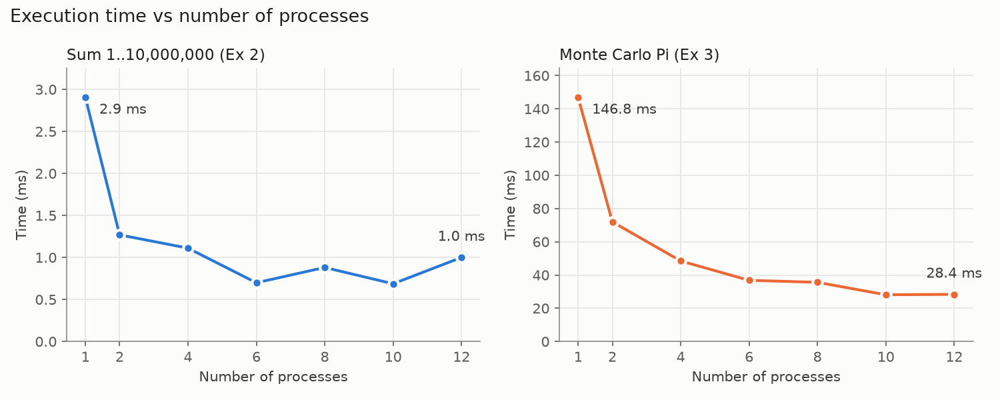
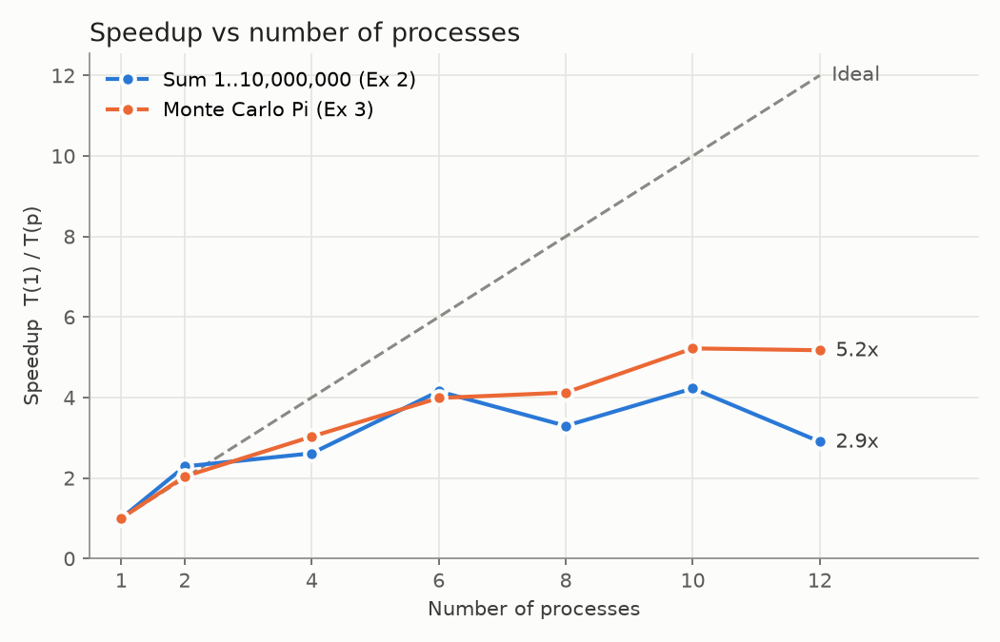

# SE4060 Parallel Computing – Lab 06: MPI

**Student ID:** IT24102182

Solutions to Lab Sheet 6 (MPI). The starter code is from
[SLIIT-FacultyOfComputing/SE4060-MPI-Part1](https://github.com/SLIIT-FacultyOfComputing/SE4060-MPI-Part1).

Tested on Windows 11 with MS-MPI (`mpiexec`) and MSYS2 UCRT64 `mpicc` / `mpicxx`, on a 12-core machine.
Each folder has an `output.txt` with sample output.

| Folder | Exercise | Files |
|---|---|---|
| [Exercise0](Exercise0) | In-class activities (Hello MPI, point-to-point messages) | `HelloMPI.cpp`, `messages1.cc`, `message2.cc`, `job1.pbs` |
| [Exercise2](Exercise2) | Parallel sum of 1..10,000,000 | `sum.c` |
| [Exercise3](Exercise3) | Monte Carlo Pi with 10,000,000 trials | `pi.c` |
| [Exercise4](Exercise4) | Time and speedup graphs for Ex 2 and Ex 3 | `benchmark.py`, `results.csv`, `time.png`, `speedup.png` |
| [Exercise5](Exercise5) | Mismatched source/destination; `message2` with `MPI_Bsend` | `mismatch.cc`, `message2_bsend.cc` |
| [Exercise6](Exercise6) | Ex 3 with `MPI_ANY_SOURCE` | `pi_any_source.c` |
| [Exercise7](Exercise7) | Ex 6 with `MPI_Bsend` | `pi_bsend.c` |

## Compile and run

```bash
mpicc  -O2 -o sum sum.c          # C programs
mpicxx -o messages1 messages1.cc # C++ programs (the starter code uses <cstdio>)
mpiexec -n 4 ./sum
```

On the lab cluster, use `mpiicpc` and submit with `qsub job1.pbs`. The executable must have the same name as the `.pbs` file.

> `messages1`, `message2`, `mismatch` and `message2_bsend` use rank 3, so they need **at least 4 processes**.
> The provided `job1.pbs` uses `NPROC=2`. Set it to 4 or more for these programs.

---

## Exercise 0 – In-class activities

- **HelloMPI**: rank 0 prints "Hello World!" and every other rank prints "Just a normal process". The order of the output lines changes from run to run because the processes run independently.
- **messages1**: rank 1 sends one integer (30) to rank 3 using `MPI_Ssend`, and rank 3 receives it with `MPI_Recv`.
- **message2**: same as messages1, but it sends an array of 10 integers.

## Exercise 2 – Parallel sum of 1..10,000,000

The range is split into `size` contiguous blocks. If `N` does not divide evenly, the first `N % size` ranks each take one extra number. Each rank sums its own block, and `MPI_Reduce(..., MPI_SUM, 0, ...)` combines the partial sums on rank 0. The result is **50,000,005,000,000**, which matches `N(N+1)/2`. It is stored in a `long long` because the value does not fit in a 32-bit `int`.

## Exercise 3 – Monte Carlo Pi

This program follows the [Dartmouth sample](http://www.dartmouth.edu/~rc/classes/soft_dev/C_simple_ex.html):

1. Each rank generates `10,000,000 / size` random points in the unit square.
2. Each rank counts the hits inside the quarter circle.
3. Each worker sends its count to rank 0 with `MPI_Send`.
4. Rank 0 receives the counts **in rank order** (source = 1, 2, 3, …) and computes `pi = 4 * hits / 10,000,000`.

Each rank seeds the random generator with `SEED + rank`. Without this, every rank would generate the same points.

Result with 6 processes: `pi ≈ 3.1421228` (error ≈ 5e-4).

## Exercise 4 – Time and speedup

Run `python Exercise4/benchmark.py` from the repo root. It compiles Ex 2 and Ex 3, runs each one with 1, 2, 4, 6, 8, 10 and 12 processes (median of 5 runs), and writes `results.csv` and the two graphs.
Time is measured with `MPI_Wtime()` between an `MPI_Barrier` and the end of the reduction. Speedup = T(1) / T(p).




| Processes | Sum time (ms) | Sum speedup | Pi time (ms) | Pi speedup |
|---:|---:|---:|---:|---:|
| 1 | 2.90 | 1.00 | 146.8 | 1.00 |
| 2 | 1.27 | 2.29 | 72.0 | 2.04 |
| 4 | 1.11 | 2.61 | 48.4 | 3.03 |
| 6 | 0.70 | 4.15 | 36.8 | 3.99 |
| 8 | 0.88 | 3.30 | 35.6 | 4.12 |
| 10 | 0.69 | 4.23 | 28.1 | 5.22 |
| 12 | 1.00 | 2.90 | 28.4 | 5.17 |

**Observations**

- **Pi** has enough work (about 147 ms on 1 process) to scale well. Speedup is almost ideal at 2 processes and reaches about 5× at 10–12 processes. It falls below the ideal line as processes are added because of:
  - start-up and communication overhead;
  - shared memory bandwidth and turbo-frequency limits when all cores are busy;
  - the machine's mix of performance and efficiency cores.
- **Sum** takes only about 3 ms on one process, so each process has very little work. Once the work is split, the fixed MPI overhead (barrier, reduce) is as large as the computation itself. The speedup is therefore noisy and stops improving after about 6 processes. In this case, adding more processes does not help.
- Both programs show the same idea: parallel speedup is limited by the ratio of computation to communication and overhead (Amdahl's law).

## Exercise 5

### 5.1 Source and destination do not match – `mismatch.cc`

Rank 1 sends to rank 3 with `MPI_Ssend`, but rank 3 calls `MPI_Recv` with **source = 2**.

**What happens:** the program **hangs (deadlock)**.
- `MPI_Ssend` is a synchronous send. It does not return until a matching receive is posted, and rank 3 never posts a receive for a message from rank 1.
- Rank 3 waits forever for a message from rank 2, which never sends one.
- Ranks 0 and 2 reach `MPI_Finalize`, but the job never finishes and had to be killed (see `output.txt`).

MPI does not report a mismatched source, destination or tag as an error. The message simply never matches.

### 5.2 `message2.cc` with Buffered Send – `message2_bsend.cc`

The sender attaches a buffer of size `MPI_Pack_size(10, MPI_INT) + MPI_BSEND_OVERHEAD` with `MPI_Buffer_attach` and sends the original array `x` with `MPI_Bsend`. The send and receive variables `x` and `y` are kept unchanged.
- `MPI_Bsend` copies the data into the buffer and **returns immediately**, without waiting for the receiver.
- `MPI_Buffer_detach` then waits until the buffered message has been delivered, after which the buffer is freed.

## Exercise 6 – Ex 3 with `MPI_ANY_SOURCE`

The sheet says "receiving Tag", but `MPI_ANY_SOURCE` is the *source* argument of `MPI_Recv`. The tag stays 0.

Rank 0 now receives the counts with `MPI_Recv(..., MPI_ANY_SOURCE, 0, ...)` and reads the sender from `status.MPI_SOURCE`.

**Comparison with Ex 3**

- **The estimate of Pi is the same** (`3.1421228` with 6 processes): every rank contributes exactly once, and addition does not depend on order.
- **The order of the "Received … from rank X" lines changes on every run.** The messages are taken in the order the workers finish, not in rank order.
- **Rank 0 never waits on a slow rank while faster results are already waiting**, which can reduce idle time when ranks finish at very different times. Here the ranks finish at nearly the same time, so the run times are similar to Ex 3.

## Exercise 7 – Ex 6 with Buffered Send

The workers send their counts with `MPI_Bsend` using an attached buffer (`MPI_Pack_size(1, MPI_LONG_LONG) + MPI_BSEND_OVERHEAD`). Rank 0 still receives with `MPI_ANY_SOURCE`.
- Each worker can return from the send straight away, without waiting for rank 0.
- The final Pi value is the same as in Ex 3 and Ex 6.
- The messages still arrive in any order.
